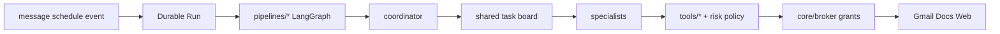

# Cognilance architecture

## Layout

```
web/                   # Next.js landing
UIs/chat/              # Next.js chat (unchanged)

agents/                # one folder per agent: agent.yaml + prompts/ + schema.py
  loader.py            #   agent.yaml -> RolePack (legacy ids reporter/follow_up still resolve)
  coordinator/  report_writer/  concept_note_writer/  email_agent/  researcher/  watcher/
tools/                 # one folder per tool: manifest.yaml (actions + risk) + tool.py + tests/
  registry.py          #   manifests, permission check, run_tool dispatch
  gmail/  google_docs/  web/  link_validate/  calendar/  time/  presenters/
pipelines/             # LangGraph graphs; every folder exposes graph.py
  shared/              #   state, streaming, ui_selector, BoardPipeline builder
  coordinator_board/   #   general: coordinator plans board tasks, specialists execute
  weekly_report/  concept_note/  email_followup/   # preset task boards
core/
  registry/            # startup validation of agents x tools x pipelines
  runtime/             # runs, board, missions, runner, event_bus, checkpointer
  broker/              # OAuth, tokens, grants, risk policy, tool proxy routers
  models/              # LLM gateway (Groq) + thinking
  context/             # env, db, request context, conversations, users, drafts, subscriptions
  signals/             # step / feedback signals for the improvement loop
api/                   # FastAPI: server.py assembles routes/*, deps.py, sse.py, auth/
workers/               # worker.py (queued runs) + schedulers/ (ticker, recurring, watcher events)
sdk/cognilance/        # Python SDK + CLI (import name: cognilance)
evals/                 # per-agent cases.yaml + cognilance-evals runner
improvement/           # placeholder for the feedback loop
data/                  # SQLite (runs, board, checkpoints): gitignored
```

One `pyproject.toml` at the root installs all of the above (`pip install -e .`).

## Request path



1. Clients call the API (`:8200`); `api/routes/chat.py` opens a durable Run.
2. A pipeline runs: `seed → coordinator_plan → specialists → coordinator_assemble → ui_selector`.
   `coordinator_board` lets the coordinator LLM plan; preset pipelines seed `preset_tasks`.
3. The coordinator writes **board tasks** assigned to specialist ids from `agents/*/agent.yaml`.
4. Specialists claim tasks and may only call tools listed in their `agent.yaml`;
   `tools/registry.run_tool` checks that and the manifest risk grade.
5. Risk grades (`read` / `draft` / `reversible_write` / `irreversible`) gate approval via
   `COGNILANCE_APPROVAL_GRADES`. Credentials never leave `core/broker`.
6. The coordinator assembles structured results; the UI selector renders a component when props exist.

## Manifests, not a registry

Nothing is discovered over HTTP. `core/registry.validate_all()` runs at API and worker
startup and fails loudly when an agent references an unknown tool, a tool has no `tool.py`,
or a pipeline lacks `ensure_graph()`.

Tool ids are `<folder>.<action>` (`gmail.send`, `google_docs.create`, `link_validate.check`).
Old ids (`docs.*`, `link.validate`) and old role ids (`reporter`, `follow_up`) are aliased.

## Demo

```bash
./scripts/start_demo.sh
# API:     http://127.0.0.1:8200/health
# Agents:  http://127.0.0.1:8200/skills/online
```
