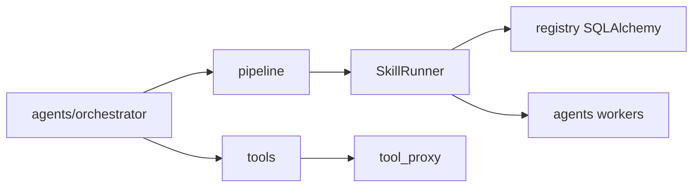

# Cognilance architecture

## Layout

```
cognilance/          # Next.js landing
SDK/cognilance/      # Python SDK (import name: cognilance)
agents/
  email_writer/      # Worker processes
  web_scraper/
  link_validator/
  proposal_writer/
  docs_creator/
  orchestrator/      # FastAPI server, OAuth, drafts, missions
registry/            # FastAPI + SQLAlchemy async (SQLite)
UIs/
  chat/              # Next.js chat
  gen-ui/            # Generative UI widgets (LangGraph Studio)
tools/               # Tool router, SkillRunner, tool-proxy, web/time, presenters
pipeline/            # LangGraph graph, nodes, planning, routing, runtime
scripts/
```

## Request path



1. Clients call the orchestrator (`:8200`).
2. Planner / DeterministicRouter choose tools: `skill:<slug>`, `app:*`, `web`, `time`, `recurring`, or `thinking`.
3. **Policy:** If the catalog has a matching skill and the required integration is connected → `skill:<skill>`. Else if the integration is connected → `app:*`. Else → `thinking` + connect CTA.
4. On `skill:<skill>`, `SkillRunner` resolves an online agent URL from the registry cache and dispatches via `CognilanceManager.run_task` (A2A HTTP).
5. Grants/tool-proxy stay for Docs/Gmail callbacks when a skill agent needs them.

## Registry

Agent directory only: register, heartbeat, discover by skill. No marketplace hire / ZIP host. Persistence is SQLAlchemy 2.x async (`aiosqlite`); tables are created on startup.

## Demo

```bash
./scripts/start_demo.sh
# Orchestrator: http://127.0.0.1:8200/health
# Registry: http://127.0.0.1:8088
```
